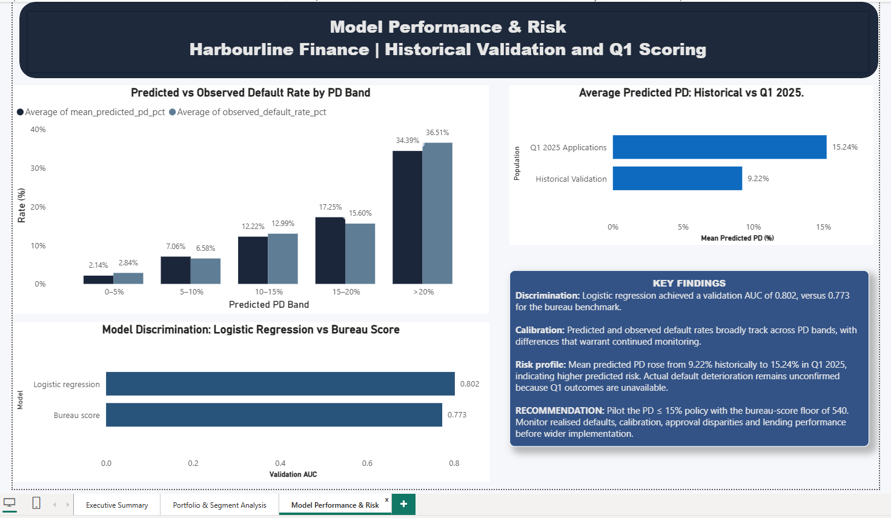

# Harbourline Finance \| Credit Risk Decisioning

**A credit-risk analytics case study using Python, SQL, scikit-learn and
Power BI**

> **Business question:** Can Harbourline Finance improve credit-risk
> decisions by combining a probability-of-default (PD) model with a
> transparent approval policy while making the trade-off between risk,
> approvals and lending volume visible to management?

## Executive summary

Harbourline Finance is a fictional consumer lender using a bureau-score
cutoff of **540**. This project analyses historical approved loans,
develops and validates a logistic-regression probability-of-default
model, scores **3,000 Q1 2025 applications**, and simulates alternative
approval policies.

The model achieved a **validation AUC of 0.802**, compared with
**0.773** for the bureau-score benchmark. In the Q1 2025 simulation,
retaining the bureau floor of 540 and approving applicants with
**predicted PD ≤ 15%** approved **2,008 of 3,000 applications
(66.93%)**. Estimated expected loss was approximately **KSh 409,083**,
compared with **KSh 1.27 million** under the current bureau-only rule.

These are **model-based estimates, not realised losses or profit**. Q1
2025 repayment outcomes were unavailable, so the higher mean predicted
PD in that population is a change in predicted risk---not proof that
actual defaults increased. The 15% cutoff is a candidate for a
controlled pilot, not a proven optimum.

## Dashboard

### Executive Summary

### Portfolio and Segment Analysis

### Model Performance and Risk

## Data and preparation

Two populations were used:

-   **Historical approved loans:** 11,582 records from January 2023 to
    June 2024, including 12-month default outcomes.
-   **Q1 2025 applications:** 3,000 records from January to March 2025,
    without observed repayment outcomes. These were scored for analysis
    and policy simulation, not used as labelled training examples.

Historical defaults totalled **1,083**, a default rate of **9.35%**.
Total historical lending was approximately **KSh 105.23 million**, with
an average loan amount of **KSh 9,085.86**.

Cleaning and data-quality checks included:

-   Parsing application dates into a consistent datetime type and
    checking expected date ranges.
-   Checking duplicate identifiers and validating exposure/recovery
    fields for impossible negative values or recoveries exceeding
    exposure.
-   Treating ages outside the plausible 18--100 range---including
    placeholder values `0` and `999`---as missing rather than real ages.
-   Setting employment-years values greater than age to missing where
    inconsistent.
-   Reviewing missing age, employment-years and income values; handling
    these within the modelling pipeline rather than using validation-set
    information.
-   Checking consistency across employment type, home ownership, loan
    purpose, channel and region.
-   Investigating credit utilisation above 100% rather than
    automatically deleting records without evidence that they were
    invalid.
-   Excluding identifiers and outcome/leakage fields from predictors.
    `interest_rate` was excluded because its availability at the
    decision point had not been established.

Historical records with missing age, employment years or income were not
automatically discarded. Missingness was preserved and handled during
modelling.

## Modelling and validation

### Target and predictors

The target was `default_12m`, indicating whether a loan defaulted within
12 months. Candidate predictors included age, employment type and years,
annual income, home ownership, bureau score, credit utilisation,
delinquencies, recent inquiries, loan purpose, loan amount, term,
debt-to-income ratio, application channel and region.

### Time-aware validation

To reduce temporal leakage, the model was trained on **2023** records
and validated on **January--June 2024** records.

  Split                          Applications   Default rate
  ---------------------------- -------------- --------------
  Training (2023)                       7,734          9.17%
  Validation (Jan--Jun 2024)            3,848          9.72%

The preprocessing pipeline used training-only median imputation for
numerical variables, missingness indicators for age, employment years
and income, standard scaling for numerical features, and one-hot
encoding for categorical features. Preprocessing was fitted on the
training data and then applied to validation data. Logistic regression
was fitted with convergence settings checked.

### Validation results

  Metric      Logistic regression   Bureau-score benchmark
  --------- --------------------- ------------------------
  ROC AUC               **0.802**                    0.773
  Gini                      0.603                    0.546

The model improved validation AUC by approximately **0.029**. Its
validation Brier score was **0.0751**. Mean predicted PD on validation
was **9.22%**, versus an observed default rate of **9.72%**---about
**0.50 percentage points lower**. Calibration by PD band showed that
predicted and observed rates broadly increased together, but differences
remained. Discrimination alone does not guarantee well-calibrated
probabilities.

## Q1 2025 scoring and policy simulation

The trained model scored 3,000 Q1 2025 applications. Their mean
predicted PD was **15.24%**, compared with **9.22%** in the historical
validation population. Since Q1 repayment outcomes were unavailable,
this is a shift in predicted-risk distribution, not confirmed
deterioration in actual defaults.

The simulations retained the bureau-score floor of **540**. Historical
approved data contained no outcomes below that cutoff, so model
performance below the floor could not be validated reliably.

  -----------------------------------------------------------------------
  Policy              Approval rate   Proposed lending Estimated expected
                                                                     loss
  -------------- ------------------ ------------------ ------------------
  Current:                   93.70%         KSh 25.70M          KSh 1.27M
  bureau score ≥                                       
  540                                                  

  Bureau ≥ 540               55.37%         KSh 15.34M          KSh 0.25M
  and PD ≤ 10%                                         

  Bureau ≥ 540           **66.93%**     **KSh 18.54M**      **KSh 0.41M**
  and PD ≤ 15%                                         

  Bureau ≥ 540               73.67%         KSh 20.38M          KSh 0.54M
  and PD ≤ 20%                                         
  -----------------------------------------------------------------------

Expected loss was estimated as:

`PD × loan amount × EAD ratio × LGD`

using an exposure-at-default ratio of **0.647** and loss-given-default
assumption of **0.628**. This simplified estimate excludes interest
income, funding costs, operating expenses and other components needed to
estimate net profit. The policy outputs are simulations, not realised
outcomes.

The 15% cutoff is a candidate compromise between risk reduction and
continued lending. Relative to the current rule, the simulation
estimated a **67.71% reduction in expected loss**, alongside a **27.87%
reduction in proposed lending volume**. The cutoff should be tested
against business objectives and observed outcomes before adoption.

## Segment impact and governance

The proposed policy reduced simulated approval rates across employment
types, channels and regions. The largest decline among reviewed segments
was for informal employment applicants (**−45.57 percentage points**).
These are descriptive policy comparisons; they do not by themselves
establish unfairness, explain causation or demonstrate a regulatory
breach.

Before wider rollout, Harbourline should:

1.  Run a controlled pilot and track realised defaults as 12-month
    outcomes mature.
2.  Monitor calibration, discrimination, approval rates and lending
    volume over time.
3.  Review subgroup impacts and investigate materially different
    outcomes.
4.  Reassess the cutoff using observed repayment performance and fuller
    profitability measures.
5.  Document limitations and restrict decisions outside the population
    for which the model was validated.

## Tools and reproducibility

-   **Python / pandas:** data cleaning, exploratory analysis, feature
    engineering and scoring.
-   **scikit-learn:** preprocessing pipeline, logistic regression and
    validation metrics.
-   **SQL / PostgreSQL:** querying and structuring analytical data.
-   **Power BI:** executive KPIs, policy comparisons, PD-band
    distribution, segment impact and model-risk reporting.

The repository should contain the notebooks, SQL queries, exported
analytical outputs and Power BI report used to reproduce the work. Do
not commit credentials, secret connection strings or private
service-account files.

## Conclusion

This case study demonstrates an end-to-end credit-risk workflow:
data-quality assessment, time-aware model validation, PD scoring, policy
simulation, segment analysis and management reporting. The model
outperformed the bureau benchmark on validation AUC, but deployment
should remain conditional on calibration monitoring, subgroup review and
observed repayment outcomes.

*Disclaimer: Harbourline Finance is a case-study scenario. Model outputs
and expected-loss figures are estimates based on stated assumptions, not
guarantees of future performance.*